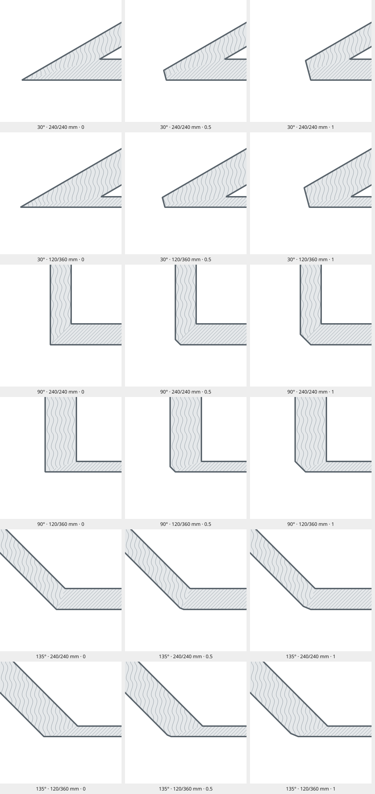

# CHAMFER-01: wall corner chamfers

Select a wall control point and adjust **Chamfer** in Object Properties.
The value ranges from 0 to 1, steps by 0.05, and defaults to **0**.

Show this row only when every selected control point belongs to a usable
two-segment corner of Walls, Counters or Stairs. Hide both label and editor for lone
endpoints, straight/duplicate-direction joins, junctions of three or more
segments, guarded local transitions, and object types without a wall-style
chamfer. Count incident same-class segments within the 0.01 mm endpoint weld
tolerance; a third duplicate segment still makes this a three-segment junction.
Whole-object selection does not expose the control point parameter. For a mixed control point
selection, hide it if any selected control point is ineligible. Hiding the row never
resets stored amounts; when topology makes the corner eligible again, show its
retained value. This is a presentation rule, not a restriction on stored data.

- **0:** Uncut corner. The offset wall edges meet at their intersection.
- **0.5:** The cutting line has travelled halfway to the full-cut position.
- **1:** Full flat cut. For equal wall thicknesses this is the former zero-miter
  bevel joining the two offset endpoint corners.

Intermediate amounts produce a straight face. They do not move one apex inward
or bend the original wall edges. Inner/re-entrant sectors are not carved out.
The setting is per control point and propagates to coincident same-class
endpoints independently of the Connected switches. Undo, redo, branch creation,
control point snapping/merging and cancelling previews retain their normal transaction
behavior. A fresh endpoint and a new subdivision point start at zero.

## Geometry contract

### WALL-JOIN-01: automatic unequal-width cap clipping

At a two-wall join with different thicknesses, both wall edges continue to their
offset-edge intersections. Trim each rectangular body to its ownership seam
before combining it with the join patches. A material-only seam is insufficient:
the original cap would leave a short step or triangular protrusion in the outline.
The material coverage fallback must use the same trimmed sources.

This automatic clipping applies even at **Chamfer 0**. It is separate from the
user's moving chamfer cut. The outline, fills, measurement boundaries and collision
geometry must agree. At zero, the expected ordinary join consists of the two far
end caps, four straight wall sides and their two shared edge intersections;
there is no exposed cap at the control point. Existing straight/near-straight
local transition guards and multi-branch rules still apply.

`check_unequal_wall_clipping.py` constructs that expected outline independently
and checks 432 angle/width/rotation/scale/object-order/endpoint-order combinations,
plus material containment and warm cache reuse. It covers the 25° acute and 150°
obtuse arrangements represented by the reported vertical/angled wall examples.

### User-controlled cut

For normalized rays `a` and `b` pointing from the joint into the walls, the
exterior cutting plane has outward normal `n = -(a + b) / |a + b|`. Its line is
therefore perpendicular to the exterior angle bisector. Let `I` be the outer
offset-edge intersection and `B` the midpoint of the two outer endpoint offsets.
For amount `c`, choose a point `P = I + c * (B - I)` on that line. Keep geometry
where `dot(X - P, n) <= 0`.

Only the line's perpendicular displacement matters; its orientation stays fixed.
The plane's defining point need not sit on the physical face for unequal,
obtuse joins. Find actual face endpoints by intersecting the line with the
existing solid boundary.

For **unequal thicknesses**, retain this same bisector orientation and put the
full-cut line through `B`. A line connecting the two original offset corners
would generally have the wrong orientation. The full cut can therefore differ
from the old bevel at unequal thicknesses. It can trim a wall's rectangular body
as well as its join patch. Apply the same cuts before outline tracing, material
ownership, coverage completion, collision geometry, measurements and export;
otherwise the body or material fallback can fill the removed corner back in.

Angular neighbors determine exterior sectors at multi-wall junctions; duplicate
rays use the widest wall. Straight continuations have no corner to cut. The
existing subpixel weld and local transition guard for nearly straight,
unequal-width walls remain: remote intersections beyond four maximum half-widths
use the local width transition, rather than producing an enormous spike. Their
local-transition shape is not an extrapolated chamfer face. Unequal-width T
transition extensions decrease with the chamfer amount.

### Independent right-angle examples

Joint `(0,0)`, first ray `(1,0)`, second ray `(0,1)`, millimeters, +Y up.

| Wall widths | Amount | Cutting line | Outer-edge intersections |
|---|---|---|---|
| 240 / 240 | 0 | x + y = -240 | (-120,-120), degenerate sharp tip |
| 240 / 240 | 0.5 | x + y = -180 | (-120,-60), (-60,-120) |
| 240 / 240 | 1 | x + y = -120 | (-120,0), (0,-120) |
| 120 / 240 | 0 | x + y = -180 | (-120,-60), degenerate sharp tip |
| 120 / 240 | 0.5 | x + y = -135 | (-120,-15), (-75,-60) |
| 120 / 240 | 1 | x + y = -90 | (-120,30), (-30,-60) |

These examples are also available as [portable JSON](chamfer-examples.json).
The zero row describes a tangent line for comparison; no cut is needed at zero.

## Saved data and migration

The internal/wire field names `firstMiter` and `secondMiter`, and the property
key `miter`, remain for implementation continuity. They now store **chamfer**
amounts: zero is none, one is full. Do not invert values in the UI adapter.
Invalid or omitted values repaired during geometry recovery default to zero.

On 18 October 2026, existing workspace plans and startup data were backed up and
their valid stored values converted with `new = 1 - old`, including explicit
history records. Intermediate old shapes are intentionally replaced by the new
cutting mechanic. Existing malformed recovery test files remain malformed.
This is a one-time workspace migration, not a runtime compatibility converter;
importing an unconverted older project interprets its numbers in the new sense.

The 17 October control gallery is historical. New behavior takes precedence over
its former Miter label/default. Object matrix, workflow and render fixtures were
refreshed for the new convention; their ordinary uncut shapes stay unchanged.

## Checks and visual references

```
python -S checks/check_chamfers.py --numeric-only
python checks/run_checks.py check_chamfers.py check_miters.py check_junctions.py check_junction_tracing_core.py check_junction_ownership_coverage.py
python checks/run_checks.py check_unequal_wall_clipping.py
python checks/run_checks.py check_chamfer_visibility.py
```

Analytic checks cover acute/right/obtuse angles, equal and unequal widths,
quarter/half/three-quarter/full cuts, plane orientation and headless clipping.
Desktop checks additionally cover rotation, scale, owner fills, scene order,
endpoint reversal and warm cache reuse. The frozen sharp-join comparison now
compares new zero to old one; it deliberately does not require intermediate
chamfers to reproduce the old pyramid geometry.

[Render manifest](reference/chamfers/manifest.json) contains 18 synthetic projects
and PNGs: angles 30°, 90°, 135°; widths 240/240 and 120/360; amounts 0, 0.5, 1.
Images use Qt/Fusion, Light Canvas, DPR 1, 250 px/m with grid/measurements off.
Brick/Wood fills make clipped material coverage visible. Recreate these with
`python checks/capture_chamfer_reference.py` only after reviewing an intentional
change. The analytic assertions are independent of these generated pictures.
The raster comparison permits at most five differing pixels per image, with
every RGBA channel difference capped at one level out of 255. Image dimensions
and the reference PNG hashes remain exact. This allowance applies only to these
18 chamfer images; geometry assertions and other render comparisons are unchanged.


