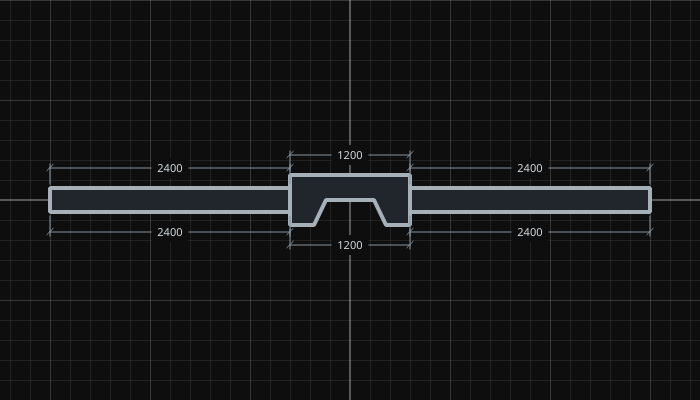
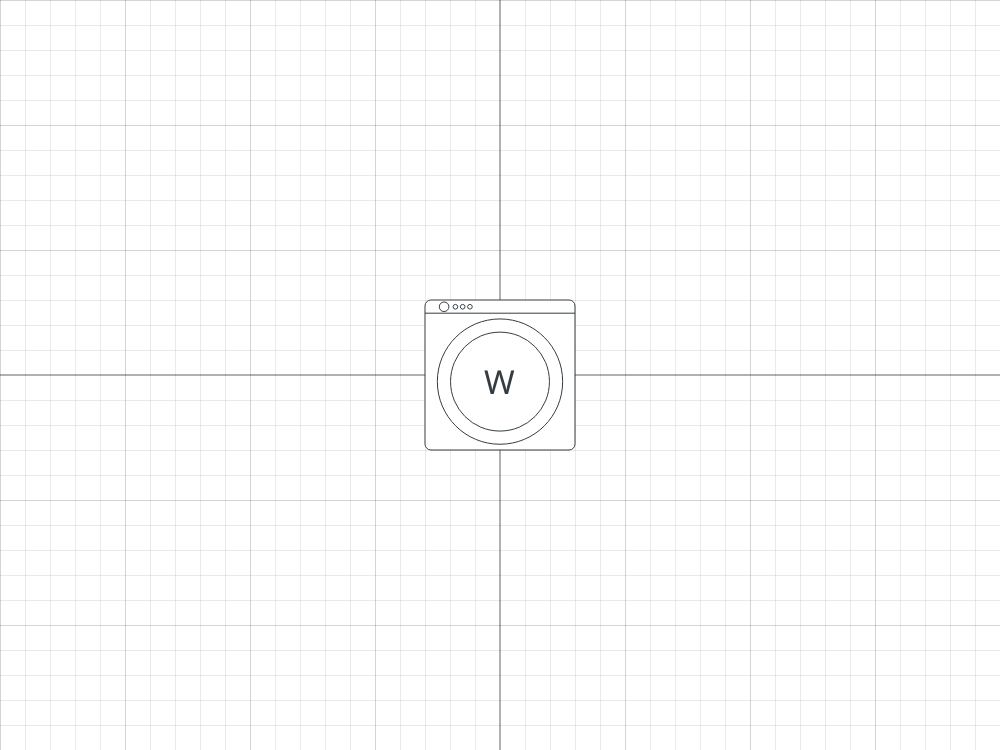

# Workflow and rendering examples

The 18 October [chamfer supplement](CHAMFERS.md) adds six portable analytic
examples and 18 angle/thickness/material renders, alongside the corpus below.
Current object/workflow/render project records use zero for an uncut corner.

These examples pair synthetic, shareable projects with frozen desktop results.
They are intended to let a new framework reproduce operations and compare
geometry, history, presentation and rendering separately. No user project or
installation preferences are included. Run commands from the workspace, one
directory above `planner-main`.

## Room to export

[Checkpoint data](reference/workflows/room-to-export.json) ·
[Saved project](reference/workflows/room-to-export.plan)

1. With snapping and connected movement disabled, draw a 4000 × 3000 room
   between (-2000,-1500) and (2000,1500), using four right-button wall gestures.
2. Drop a door at the bottom center and a silled window at the top center. Drop
   Desk at (-900,-400) and Dining Chair at (900,-400).
3. Group the furniture. Translate it by (100,200) and rotate 15° about the shared
   bounding-box center. Undo and redo the transform.
4. Save, create a new project and reopen the saved project. Geometry, groups and
   attachment references must survive.
5. Enter Export. Toggle its grid override, undo and redo it, then press Delete.
   Scene geometry and scene undo history must remain unchanged. Return to Build:
   its original grid setting must be restored.

The checkpoint after each named operation records ordered scene records,
selection, scene/export history counts, camera, export overrides and dirty state.
Scene coordinates remain full precision. Numeric comparison allows only floating
point roundoff (absolute 1e-8, relative 1e-12), not measurement display rounding.

## Attachment lifecycle

[Checkpoint data](reference/workflows/attachment-lifecycle.json) ·
[Saved project](reference/workflows/attachment-lifecycle.plan)

1. Start with a 4000 mm wall of thickness 240, a door over fractions 0.1–0.3 and
   a 1200 × 500 fireplace over fractions 0.6–0.9.
2. Hide the parent: all three objects hide. Undo. Delete the parent: the wall and
   both children disappear. Undo restores the objects and parent references.
3. Set wall thickness to 800. Fireplace depth becomes 800. Undo restores wall
   thickness 240 and fireplace depth 500.
4. Save/new/reopen, then exercise the same independent export history and blocked
   Delete sequence as the room workflow.

Together the workflows have 20 frozen checkpoints and additional independent
assertions for counts, attachments, geometry preservation and undo isolation.
The desktop adapter is [check_parity_workflows.py](../../checks/check_parity_workflows.py).
It synthesizes wall pointer events and invokes the actual MIME drop handler.
Grouping, transform, file operations and export settings use application command
entry points. Native OS drag loops and file chooser dialogs are not exercised.
The script's explicit operation sequence is the replay recipe; JSON checkpoints
are expected outputs, not a generic JSON event interpreter.

## Object render corpus

[Manifest](reference/rendering/manifest.json) contains 32 cases: every one of the
23 model types at 100 px/m, seven furnishing details at 250 px/m, and Washer SVG
exports in digital and architectural 1:100 modes. Each case includes the exact
`.plan`, crop in millimeters, theme, scale, output dimensions and a PNG. SVG cases
also include the exported vector file and a raster preview. The named bounds are
lower-left X/Y followed by width/height, with +Y up.

| Example | What to inspect |
|---|---|
| [Fireplace](reference/rendering/fireplace.png) | Continuous U outline, wall cut, front/back measurements |
| [Elevator](reference/rendering/elevator.png) | Architectural graphic and line weight; no flip requirement |
| [Angle guide](reference/rendering/angleguide.png) | Three-point angle annotation and exact right-angle marker |
| [Column](reference/rendering/column.png) | Elliptical body, distinct from Pillar |
| [Sliding door](reference/rendering/slidingdoor.png) | Panel/track geometry and opening measurements |
| [Washer](reference/rendering/washer.png) | Theme font and glyph placement relative to circular detail |
| [Treadmill](reference/rendering/treadmill.png) | Rounded SVG corners and scaled linework |
| [Double sink](reference/rendering/kitchen_sink_drainer_dbl2.png) | Drainers and strokes within the graphic |
| [Office chair](reference/rendering/chair_office.png) | Arms/seat outlines at 250 px/m |
| [Armless chair](reference/rendering/chair_office_armless.png) | Distinguish the two chair definitions |
| [Dining table](reference/rendering/table_dining_round_6.png) | Circular table geometry |
| [Dining compound](reference/rendering/compound-dining.png) | Embedded custom definition, child order and chair/table occlusion |
| [Digital SVG](reference/rendering/washer-svg-digital.svg) | Coordinate dimensions; baked strokes, outlined glyphs |
| [Architectural SVG](reference/rendering/washer-svg-architectural.svg) | Physical millimeter size at 1:100 |





The corpus fixes Fusion/Dark UI, Qt version (in manifest), bundled fonts and DPR 1.
Dark and Light Canvas change paint roles; UI styling stays fixed. Measurements
are enabled in millimeters with both opening sides visible. The single-object
seeds intentionally avoid selection handles and unrelated scene occlusion. Use
the earlier [UI gallery](reference/GALLERY.md) for selected/hovered controls and
panel layout, and the workflow projects for multi-object scene state.

## Replay, comparison and updating references

```
python checks/run_checks.py check_object_behavior_matrix.py check_parity_workflows.py check_parity_rendering.py
```

Default runs compare frozen results without writing references. Rendering compares
decoded RGBA pixels, dimensions and a SHA-256 digest, rather than PNG compression
bytes. SVG checks additionally retain size/viewBox/path counts and require vector
output without raster images or non-scaling strokes. Its PNG preview uses the
desktop SVG preview renderer. This is not proof of rendering in every external
SVG viewer.

Exact pixels are a regression target on the recorded Qt/font/platform baseline.
For a browser port, compare structure and coordinates first, then review raster
differences under a declared browser/font/DPR configuration. Do not loosen all
comparisons to hide missing geometry, changed stroke weights or displaced text.
Browser antialiasing may need a reviewed image tolerance; none is implicitly
approved here.

Only after reviewing an intentional change, regenerate with:

```
python checks/check_object_behavior_matrix.py --record
python checks/check_parity_workflows.py --record
python checks/check_parity_rendering.py --record
```

A furnishing definition is authoritative for its dimensions and artwork. If a
catalog edit makes a frozen furnishing example stale, update the example rather
than changing the definition to match it. Record an individual reviewed case with:

```
python checks/check_parity_rendering.py --record-case kitchen_sink_drainer_dbl2
```

Other cases are still verified and their reference files remain unchanged.
The published `kitchen_sink_drainer_dbl2` example ID and filenames are retained
for stable links; its current catalog definition is `sink_drainer_dbl2`
(1200 × 500 mm).

These are test-only generators. They isolate startup/session/preferences in a
temporary folder and do not rewrite furnishing definitions or application code.
The existing gallery and new corpus were captured at different points on the
same day; each has its own manifest and scope. New examples add coverage rather
than silently replacing the earlier controls reference.
