# Desktop reference gallery

Generated explicitly by `checks/capture_parity_reference.py`.

Images and JSON metrics are dated observations, including their shortcut hints.
Use the current [interaction contract](../INTERACTIONS.md) for keyboard bindings:
`G` toggles the grid, `Ctrl+G` groups, `H` hides selected objects, `Ctrl+H` hides
unselected objects, and `Alt+H` restores hidden objects.

These dated captures may show the older 80/120/160/240 mm factory wall presets.
Current defaults are 100/150/200/300 mm; old projects/templates can still display
the captured values. See the current [interaction contract](../INTERACTIONS.md)
and preset regression checks for default and persistence behavior.

Offscreen content captures omit OS frames and do not capture the mouse cursor.
See `manifest.json` for environment/source hashes, and each JSON for measured control/layout properties.

## build

Build, selected wall, properties and toolbar

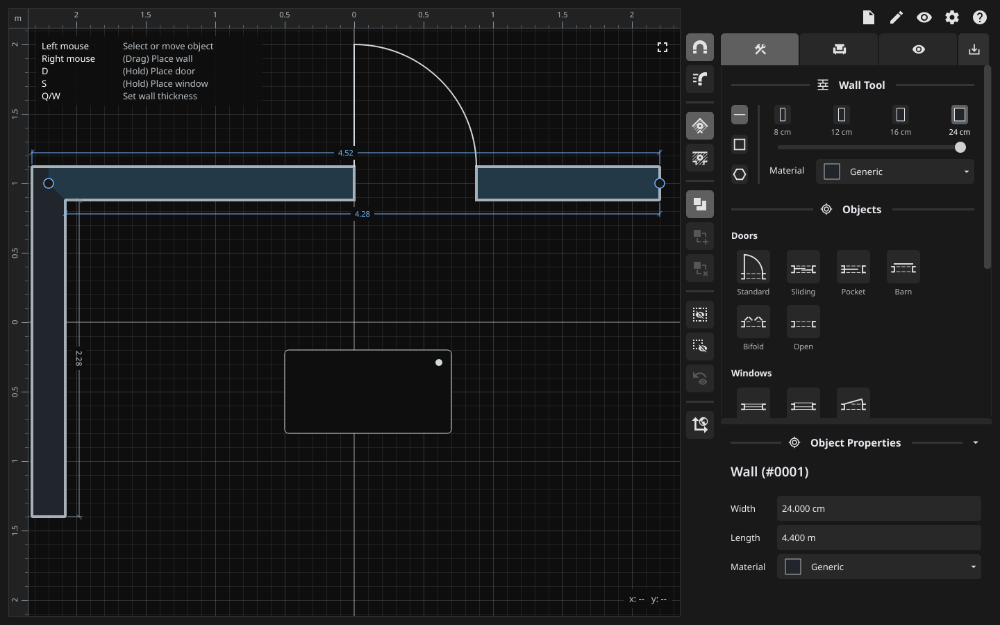

[Metrics](build.json)

## build-tools-full

Complete Build palette including Misc and Annotations below the fold

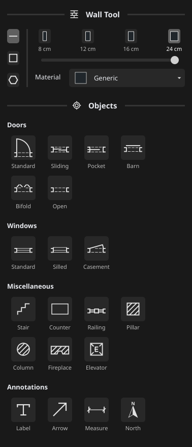

[Metrics](build-tools-full.json)

## furnish

Furnishing palette, captions, categories and search

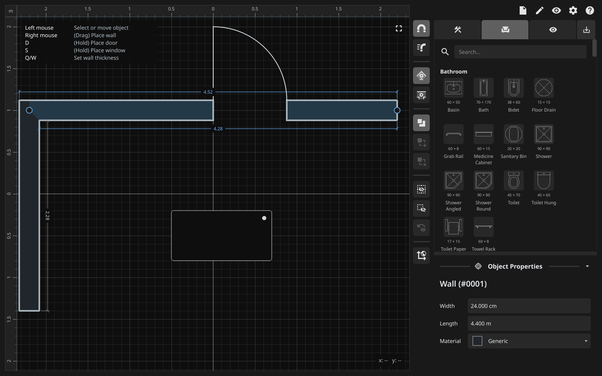

[Metrics](furnish.json)

## visibility

Visibility hierarchy and properties layout

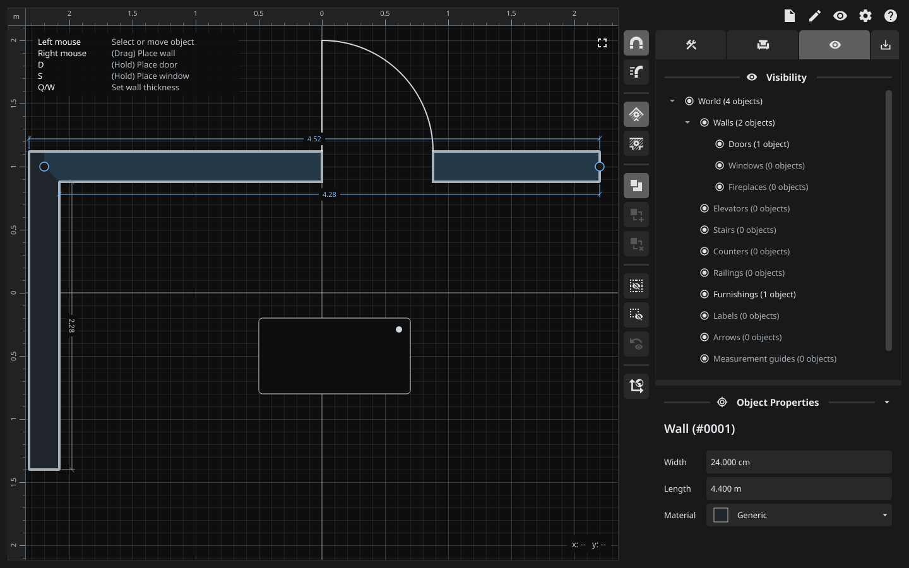

[Metrics](visibility.json)

## export-png-digital

PNG, Digital; Canvas/Border/Grid expanded

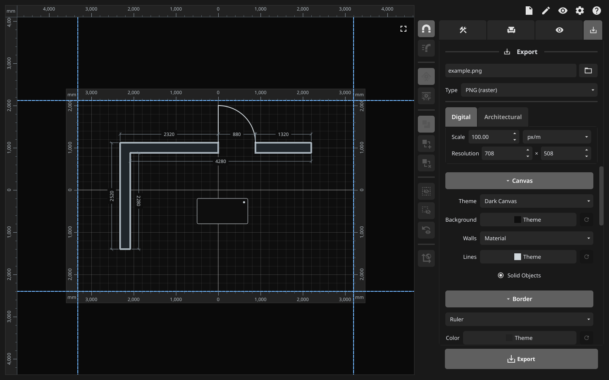

[Metrics](export-png-digital.json)

## export-png-architectural

PNG, Architectural; Canvas/Border/Grid expanded

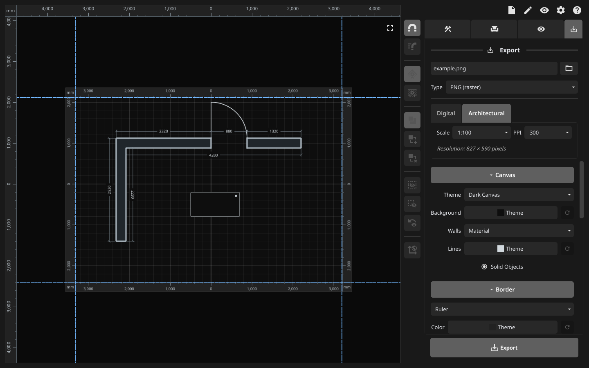

[Metrics](export-png-architectural.json)

## export-svg-digital

SVG, Digital; Canvas/Border/Grid expanded

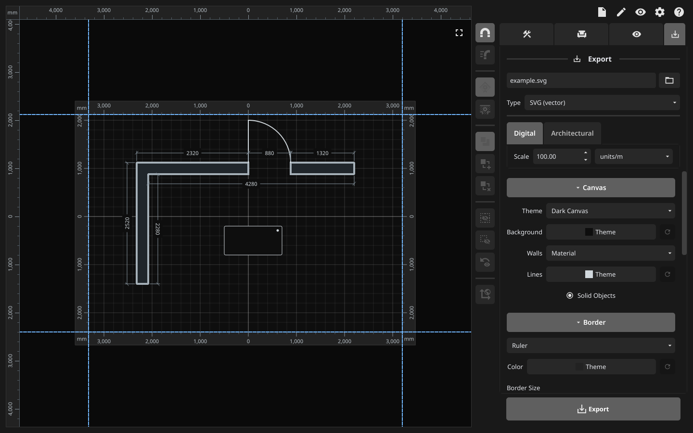

[Metrics](export-svg-digital.json)

## export-svg-architectural

SVG, Architectural; Canvas/Border/Grid expanded

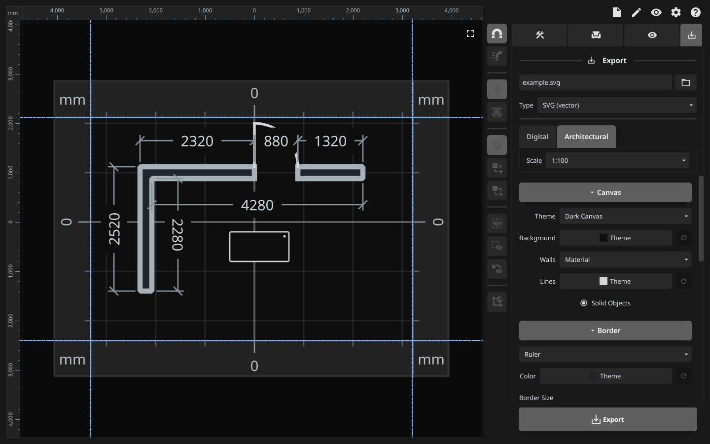

[Metrics](export-svg-architectural.json)

## composite-disabled

Vignette off and texture None: labels and controls disabled

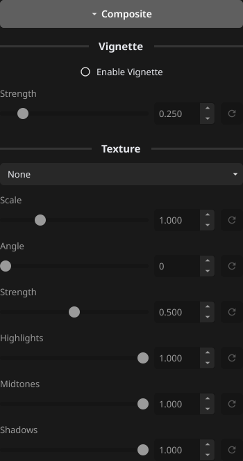

[Metrics](composite-disabled.json)

## composite-enabled

Vignette enabled and first available texture; control ranges/defaults

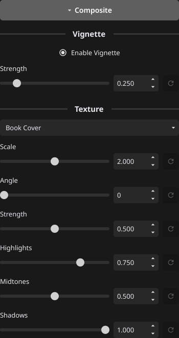

[Metrics](composite-enabled.json)

## export-section-canvas

Complete Export Canvas section

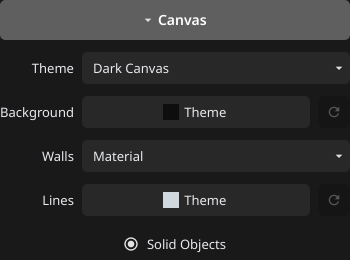

[Metrics](export-section-canvas.json)

## export-section-border

Complete Export Border section

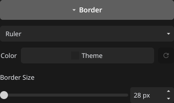

[Metrics](export-section-border.json)

## export-section-grid

Complete Export Grid section

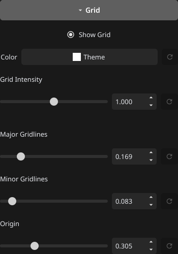

[Metrics](export-section-grid.json)

## export-section-line-weight

Complete Export Line Weight section

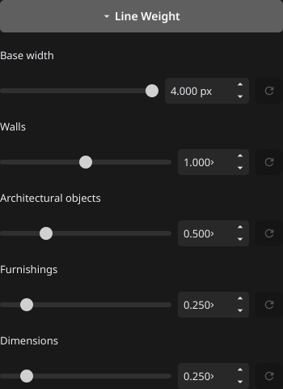

[Metrics](export-section-line-weight.json)

## export-section-measurements

Complete Export Measurements section

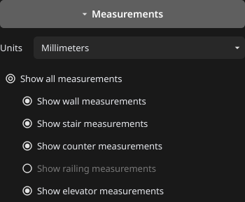

[Metrics](export-section-measurements.json)

## export-section-composite

Complete Export Composite section

[Metrics](export-section-composite.json)

## export-section-visibility

Complete Export Visibility section

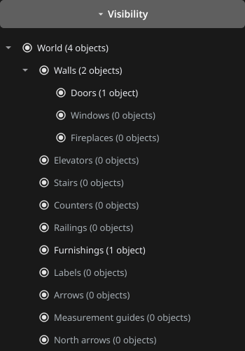

[Metrics](export-section-visibility.json)

## color-picker

HSV/RGB/hex content; popup positioning and dismissal are tested separately

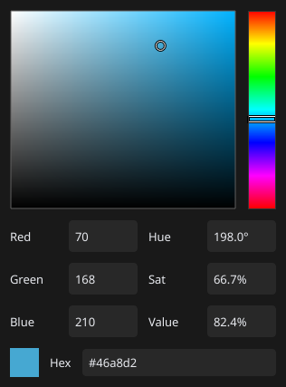

[Metrics](color-picker.json)

## dropdown

Styled material dropdown, initial top scroll

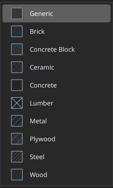

[Metrics](dropdown.json)

## file-menu

Menu row spacing, separators, shortcut alignment and disabled Revert

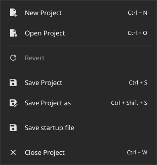

[Metrics](file-menu.json)

## settings-0

Settings: Build

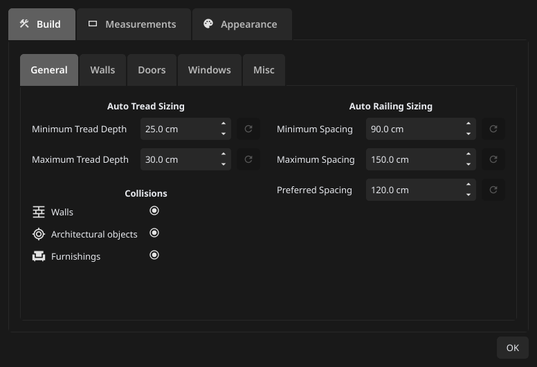

[Metrics](settings-0.json)

## settings-1

Settings: Measurements

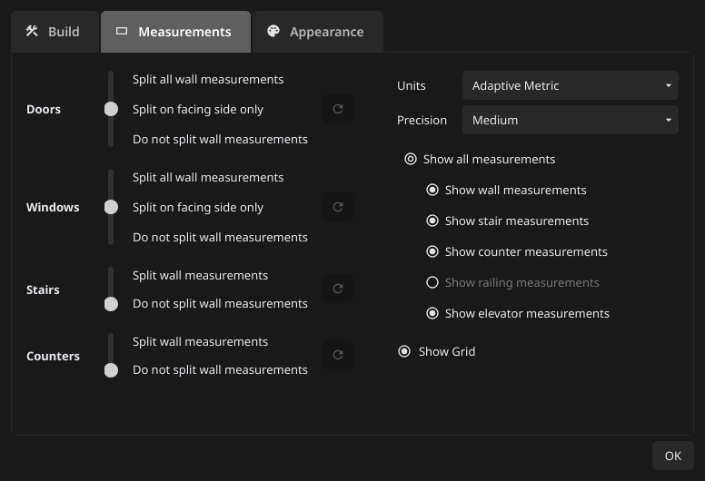

[Metrics](settings-1.json)

## settings-2

Settings: Appearance

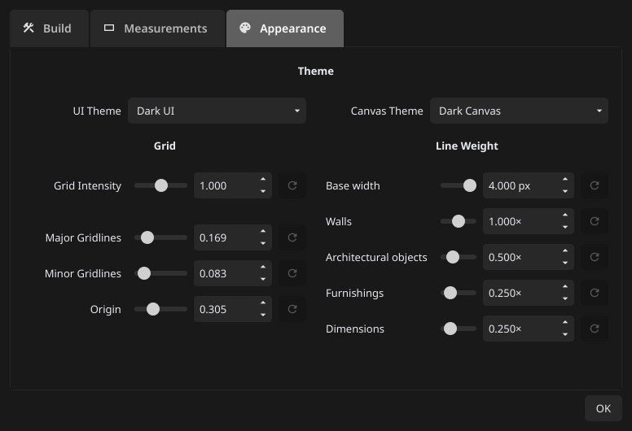

[Metrics](settings-2.json)

## settings-build-1

Settings Build: Walls

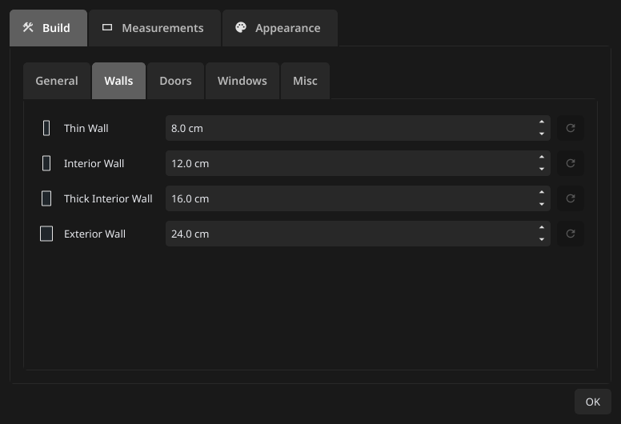

[Metrics](settings-build-1.json)

## settings-build-2

Settings Build: Doors

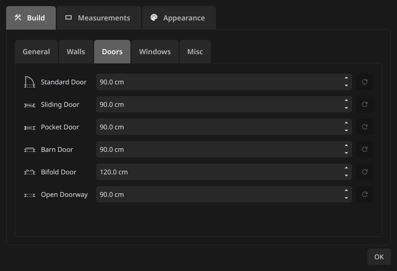

[Metrics](settings-build-2.json)

## settings-build-3

Settings Build: Windows

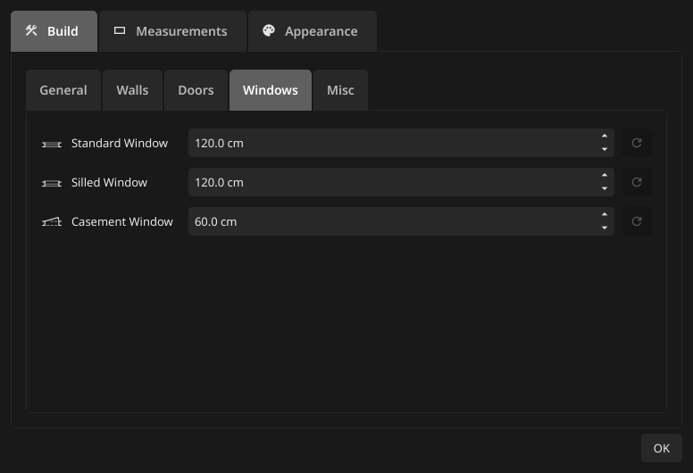

[Metrics](settings-build-3.json)

## settings-build-4

Settings Build: Misc

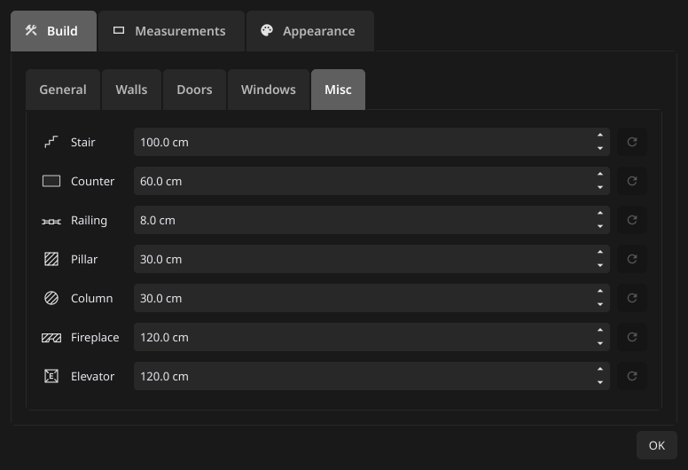

[Metrics](settings-build-4.json)

## controls

Shared buttons, fields, arrow treatment and sliders

[Metrics](controls.json)

## controls-hover

First button hovered; checked and disabled siblings unchanged

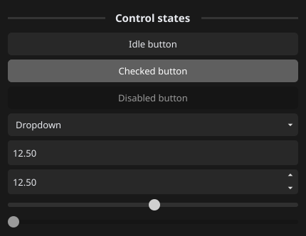

[Metrics](controls-hover.json)

## controls-pressed

First button pressed; checked and disabled siblings unchanged

[Metrics](controls-pressed.json)

## dialog-sizing

Message minimum size and button placement; status icons covered by popup check

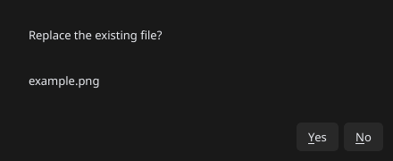

[Metrics](dialog-sizing.json)

## build-light

Same layout with independent light UI/canvas palettes

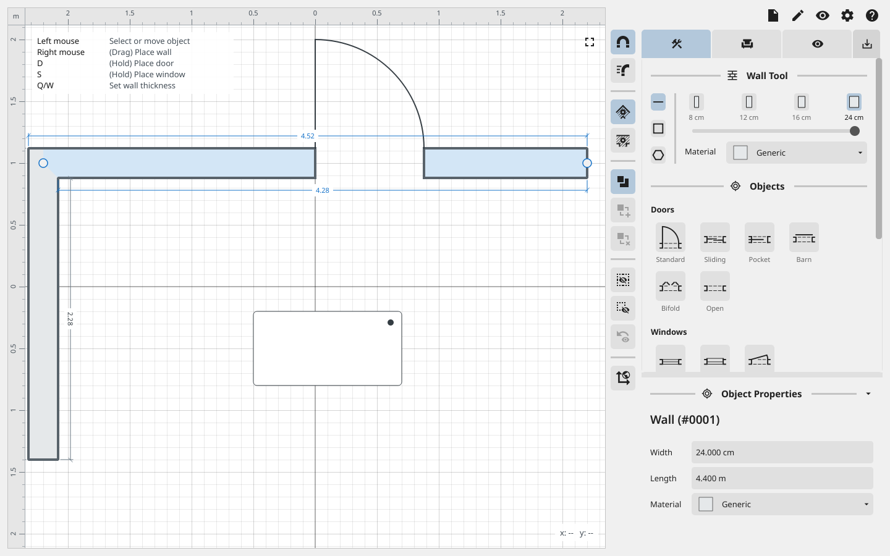

[Metrics](build-light.json)

