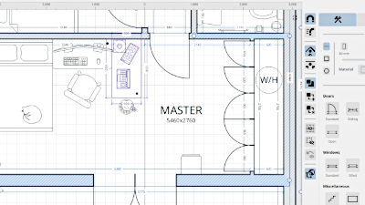
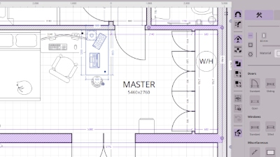
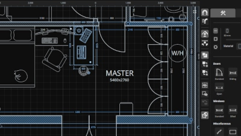
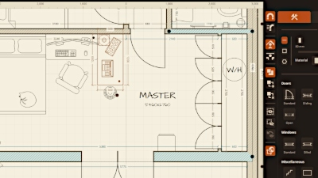
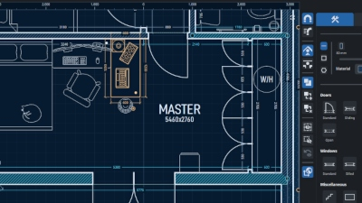
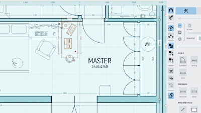
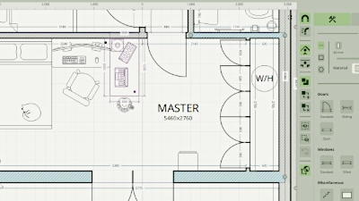
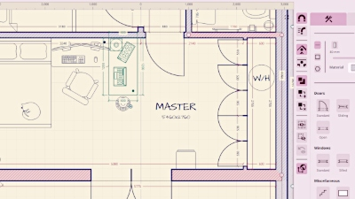

# Appearance and color controls

## Themes

Planner allows you to set a theme for the canvas and UI independently. Theme
controls can be found under **Appearance** in the **Settings** menu.

UI themes color controls, panels and icons. Canvas themes color the canvas background,
the grid, measurements and canvas objects. Canvas themes also set the canvas text.

The **Export** tab can use its own canvas theme and color overrides without changing your
editing view. See [Exporting and printing](export.md).

## Theme palettes

Give these combinations a try:

| | UI | Canvas |
|---|---|---|
|  | Light | Light |
|  | Heather | Magnetite |
|  | Dark | Dark |

| | UI | Canvas |
|---|---|---|
|  | Dark Fire | Vellum |
|  | Dark Ice | Deep Blueprint |
|  | Light Ice | Cyan Blueprint |
|  | Sage | Graphite |
|  | Candy Shop | Risograph |

## Grid and line weight

In the **Appearance** tab of the **Settings** menu, there are controls to toggle the grid and its intensity,
and adjust the line weight of objects on the canvas.

The grid can be toggled here or by tapping `G` on the keyboard. The **Grid** controls allow you to set the
opacity of the grid overall, and individually for major and minor gridlines, as well as the origin.

The **Line Weight** options allow you to set a base line weight for canvas items, and a multiplier for walls, architectural objects, furnishings and measurements.

[> Next: Projects and recovery](projects.md)

[< Previous: Units, dimensions and visibility](dimensions.md)

[Back to Help](README.md)
