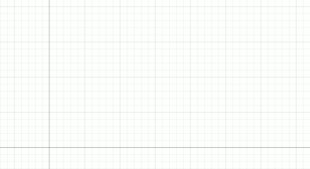
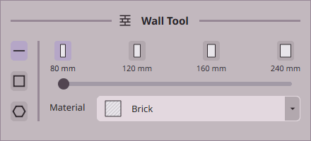
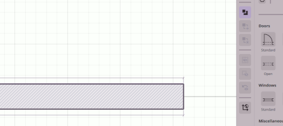
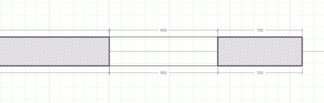
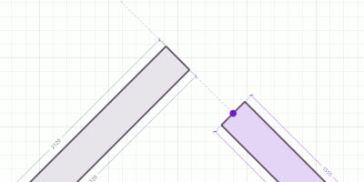
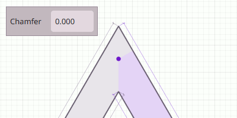
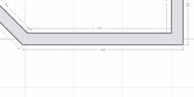

# Drawing walls and architectural objects

| | |
|---|---|
 | Build tab |

## Walls

### Placing a wall

Hold `Right-mouse` and drag anywhere on the canvas to draw a wall. Start a new wall at the control point of an
existing wall to keep walls connected.

Alternately, you can hold `Shift` while dragging the control point of an existing wall to extrude a new wall
out from that point. The new wall will inherit the thickness and material of the old wall.

### Wall tool

At the top of the **Build** tab, you can set the wall thickness and wall material
for the wall tool. The buttons on the left hand side control the shape of the wall
drawn by the wall tool.

Once a wall is drawn, its thickness and material can be edited in the
**Object Properties** panel. Thickness defaults can be set in the **Settings** menu.

Hover over a wall's control point and drag it around to reshape the wall once it has
been placed. Holding `Ctrl` while doing so will snap the point to 15 degree increments. With **Local Transforms** enabled, angle snapping uses the wall’s initial orientation as its reference.

| | | |
|:---:|:---|:---|
|  | **Line** | Wall tool draws a line. |
|  | **Rectangle** | Wall tool draws a rectangle. |
|  | **Polygon** | Wall tool draws a polygon. |

The rectangle tool draws four joined walls in one operation. Holding `Shift`
expands the shape out from the starting point, holding `Ctrl` constrains it to a square,
holding both draws a centered square. The polygon tool uses the same controls to approximate a circle or ellipse with straight wall segments. Use the `Mouse wheel` during drawing to change the number of sides.

## Doors and windows

Drag a door or window from the **Objects** menu onto a wall. Drop it onto a wall to
place it. Its length can then be adjusted using its control points.

Additional properties related to the fixture can be set in the
**Object Properties** panel, or alternatively via the `Right-click` context menu.

Moving or resizing the wall updates all its attachments as well.

Hold `D` for repeated door placement or `S` for repeated window placement.
Use the `Mouse wheel` while holding the key to cycle types, and release the key to leave the
placement tool. Hold `Ctrl` during directional opening placement or a body
drag to choose its orientation with the pointer.

Some door and window types are directional, and have a facing or hinge side. The orientation of the object can be switched
through the **Object Properties** panel, the `Right-click` context menu or by selecting the object and holding `Ctrl` while dragging
the mouse. The object will attempt to face the direction of the cursor.

## Corners and chamfer

Walls join when their control points snap together. When walls join, a miter
joint is formed.

Select the control point of two joined walls, and the **Chamfer** property in the **Object Properties**
panel will allow you to control the sharpness of that joint.

Use **Subdivide Wall** in a wall's context menu to split it without moving its
control points. The split uses a nearby clear position if the midpoint is occupied.

Connected control points can be dissolved in the same manner, provided the new wall segment doesn't
collide with anything it's not allowed to collide with (subject to collision options in the **Settings** menu).

## Other architectural objects

 **Stairs**, **Counters** and **Railings** use the same control point behavior as walls, and all the
 same editing controls are available for those objects as well.

- **Stairs:** connect multiple stairs together to form a chain. The autosize option chooses tread spacing based on the size of the staircase - turn it off to use the manual sizing controls. Connected stairs can form landings.
- **Counters:** can be drawn out and connected together like walls.
- **Railings:** are similar to walls as well, with options for automatic or manual post count.
- **Pillars:** are a rectangular block of wall, with resize and rotation handles instead of control vertices.
- **Columns:** are exactly like pillars, except with a circular or elliptical body.
- **Fireplaces:** attach to walls. Drag onto a wall to position the fireplace. It can sit flush on either side or straddle the wall.

## Annotations

Annotations help you mark your map.

Add labels, arrows, custom measurements or other annotations from the **Annotations** submenu.

[> Next: Selecting, moving and editing](editing.md)

[Back to Help](README.md)
