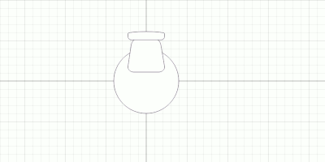

# Furnishings and custom arrangements

| | |
|---|---|
 | Furnish tab |

## Adding a furnishing

Furnishings can be found in the **Furnish** tab. Drag one out from the panel and
drop it onto the canvas to place it.

Alternatively, hit `Space` on the canvas to
bring up the furnishing quick-search menu - start typing, select a furnishing and
it'll be dropped onto the canvas at the current mouse position.

\
*Furnishing quick-search menu*

Once placed, furnishings can be dragged around to relocate them. They can be
resized using their resize handles or rotated using the rotation handles.

Properties can also be manually set in the **Object Properties** panel.

More info on object manipulation can be found in the [editing guide](editing.md).

## Searching for furnishings

Searching matches by name, category, keywords or dimensions. Plurals will match singular
forms and spelled out numbers will match digits. For example, `office chairs` and `two seater sofa`
will match `office chair` and `2 seater sofa` respectively. Hyphens, commas and spaces
separate words.

To search by dimensions, enter either one or two numbers. A single number matches either
dimension. Two numbers, such as `40 60`, match both dimensions in either order.
Use `w:` and `l:` to specify width and length. By default, dimensions prefer
the units used by the project, but can also match other units. Specify units explicitly to restrict
the search, eg. `w:30in l:40in` for inches.

## Draw order

Furnishings draw in the order they're placed on the canvas. If you find a furnishing
is drawing underneath another one, or vice versa, you can `Right-click` the offending
furnishing/s, and select **Bring to Front** or **Move to Back**. This will change the
drawing order of the selected furnishings.

## Reusable furnishings

### Create a reusable furnishing

Furnishings can be grouped together into new furnishing objects. This allows you
to reuse arrangements across projects or quickly reuse the same setup multiple times
across a plan.

1. Arrange two or more furnishings on the canvas.
2. Set their sizes, rotations and drawing order.
3. Select them, `Right-click` and choose **Create Furnishing from Selection**.
4. Choose a name and category, then press `Enter` to save.

A reusable furnishing can also be decomposed into its components on the canvas.
`Right-click` one and choose **Decompose** to replace it with its individual components.
The furnishing remains available in the **Furnishings** catalog.

### Sharing

Saving a project embeds the custom furnishings used by that project, so projects
can be shared between friends or coworkers. Unused custom library items are not included.

If a required compound furnishing definition is missing, Planner tries to recover its
children. Review any warnings before saving a recovered copy.
See [Saving and recovery](projects.md).

[> Next: Reference image](reference.md)

[< Previous: Selecting, moving and editing](editing.md)

[Back to Help](README.md)
