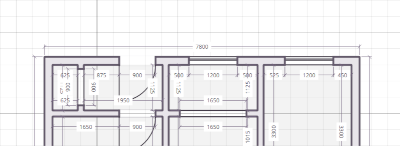
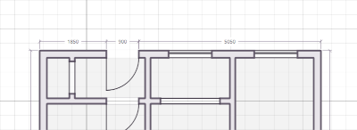
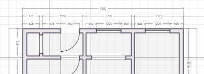
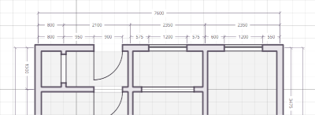

# Units, dimensions and visibility

## Units and precision

You can set the units used by Planner in the **Settings** menu. Planner uses
metric in millimeters by default, but this can be changed to imperial units if you
prefer working with inches or feet.

Metric options are millimeters, centimeters, meters and Adaptive Metric. Adaptive Metric
follows the grid's major interval at the current zoom or export scale.

Imperial units are either inches only, or feet and inches. Measurements displayed on the
canvas use fractions; other UI controls use decimal inches.

Changing units does not resize your drawing.

The **Canvas Precision** option in the **Settings** menu affects displayed canvas dimensions,
not the underlying dimensions or the precision of property controls:

| | |
|---|---|
| **High** | Nearest 1 mm, or nearest 1/16 inch. |
| **Medium** | Nearest 5 mm, or nearest 1/4 inch. |
| **Low** | Nearest 20 mm, or nearest inch. |

Medium is the default.

## Shown dimensions

Use **View > Toggle dimensions**, or press `M`, to show or hide dimensions. Walls, stairs, counters and railings have separate controls in **Settings > Dimensions**.

### Wall dimensions

The **Mode** setting controls how wall dimensions are drawn:

| | |
|---|---|
| **All** | Draws interior and exterior wall dimensions. |

| | |
|---|---|
| **Exterior** | Draws a single exterior dimension chain, divided according to the split settings. |

| | |
|---|---|
| **Exterior stacked** | Draws up to three exterior dimension chains: openings closest to the wall, room divisions in the middle and the overall length on the outside. |

Planner uses **Exterior stacked** by default. In this mode, **Wall reference** lets you choose between measuring from wall centerlines or wall faces.

In **All** and **Exterior** modes, doors, windows, stairs and counters can split wall dimensions where they touch or intersect. Configure these split settings under **Settings > Dimensions**.

### Individual dimensions

The category controls apply to entire classes of objects. To hide an individual object's dimension, `Right-click` it and choose **Hide Dimension**. Choose **Show Dimension** to restore it.

These actions are available where the object can contribute dimensions in the current mode.

#### Dimension side

When doors or windows are set to split dimensions on their **Facing side**, use **Flip Dimension** to move an object's dimension to the other side of the wall. You can find it in **Object Properties** or the `Right-click` menu. The object itself stays facing the same way.

This option isn't needed in **Exterior** or **Exterior stacked** mode or when dimensions are drawn on both sides. If you've hidden the dimension manually, show it again before flipping it.

## Object visibility

| | |
|---|---|
 | World tab |

The **World** tab toggles visibility for entire object categories. Objects can also be
hidden on a per object basis,
and then unhidden at a later point.

| | | | |
|:---:|:---|:---|:---|
|  | **Hide Selected** | `H` |  Temporarily hide selected objects. |
|  | **Hide Unselected** | `Ctrl + H` |  Temporarily hide unselected objects. |
|  | **Unhide All** | `Alt + H` |  Restore all temporarily hidden objects. |

Hiding a wall hides its attached objects as well. If an object does not return with
Unhide, ensure that its category and the master visibility control are enabled.

Export has its own visibility and measurement overrides. See
[Exporting and printing](export.md).

[> Next: Appearance and color controls](appearance.md)

[< Previous: Toolbar Buttons](toolbar.md)

[<< Back to Help](README.md)
