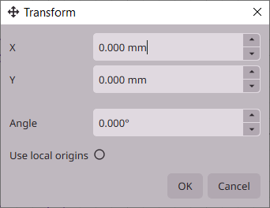
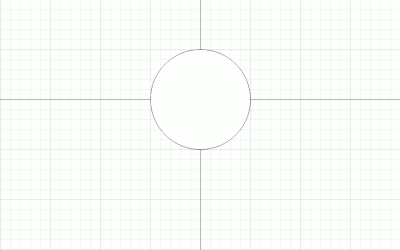
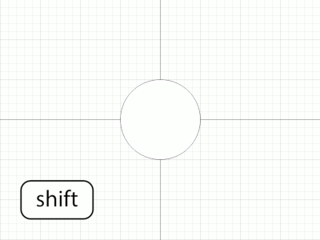
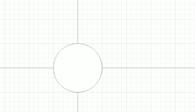
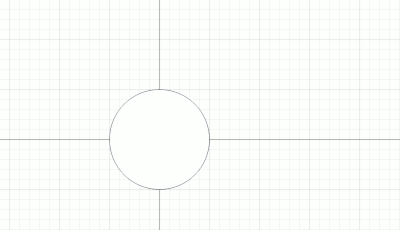
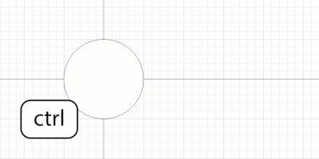

# Selecting, moving and editing

## Selection and properties

| | |
|---:|---|
| `Left-click` | Select an object. |
| `Left-drag` | Box-select objects. |
| `Shift + box-select` | Add enclosed objects to selection. |
| `Ctrl + box-select` | Remove enclosed objects from selection. |
| `Shift + click` | Add object to selection. |
| `Ctrl + click` | Remove object from selection. |
| `Ctrl + A` | Select all. |
| `Ctrl + Shift + A` | Clear selection. |

**Object Properties** applies to the current selection. Objects of the same type can be
edited together. A field showing different values represents a mixed selection.
Entering a value applies it to the selected targets.

Click a numeric field to type, or drag it horizontally to adjust it. Hold `Alt`
while dragging for finer adjustments. You can also enter basic expressions like `+4` or `*0.5`.

## Moving and duplicating

| | |
|---:|---|
| `Shift + drag` | Duplicate selection. |
| `Arrow keys` | Nudge selection. |
| `Shift + Arrow` | Duplicate and nudge selection. |
| `Delete` | Delete selection. |
| | |
| `Ctrl + C` | Copy selection. |
| `Ctrl + X` | Cut selection. |
| `Ctrl + V` | Paste at cursor. |
| `Ctrl + Shift + V` | Paste in place. |
| | |
| `T` | Precise translation and rotation. |

Press `T` to open the **Transform** menu for precise translation and rotation. Shared
rotation uses the chosen pivot, or the selection center if no pivot is set.
**Use local origins** rotates each object around its own center.

Press `Escape` or `Right-click` during a move to restore its starting state.
`Delete` removes the selection. Deleting a wall also removes its attachments.

## Resize and rotation handles

Most objects without control points offer resize and rotation handles.
Initially, an object is in resizing mode when it's selected. Click it once more
to activate rotation mode.

### Resizing

| | |
|---:|---|
| `Shift` | Expand from center. |

In resize mode, corner handles resize proportionally, keeping the opposite corner fixed.
Side handles resize one dimension, keeping the opposite edge fixed.
Hold `Shift` while resizing to keep the object's center fixed instead.

### Rotation

| | |
|---:|---|
| `Shift` | Duplicate and rotate. |

In rotation mode, drag a corner handle to rotate the object. Drag the pivot to change the center of rotation. `Double-click` the pivot to return it to the object's center.

When snapping is enabled, rotation snaps to 15-degree increments. With Local
Transforms enabled, these steps start from the object's angle at the beginning
of the rotation. Global transforms use the plan's fixed angles instead.

## Snapping and constraints

| | | |
|:---:|:---|:---|
|  | **Snapping** | Enable or disable snapping. Hold `Alt` to toggle this setting while the key is pressed. |
|  | **Snapping Options** | Configure which objects form snapping targets. |

The toolbar buttons control snapping to the grid, control points, midpoints and alignment
targets. Hold `Alt` to temporarily invert the overall snapping setting.
Object footprints and control points can supply snapping points when moving
whole objects.

Hold `Ctrl` during a body drag to constrain translation to an axis. During a
control point drag, `Ctrl` constrains movement to axes spaced 15 degrees apart.
They start at the opposing endpoint. Use the `Mouse wheel` to switch the origin between
endpoints. Global transforms align the axes to the plan. Local transforms align
them to the object's initial direction.

## Connected movement and groups

### Connected objects
| | | |
|:---:|:---|:---|
|  | **Connected Points** | Moving a wall or its control points also moves connected control points and control points that intersect the wall’s body. |
|  | **Connected Objects** | Objects of the same class move together as a whole when their bodies touch or overlap. |

### Grouped objects

| | | | |
|:---:|:---|:---|:---|
|  | **Group Toggle** | `Ctrl + Tab` | Enable or disable grouped selection. |
|  | **Add to Group** | `Ctrl + G` | Create or add to a group using the current selection. |
|  | **Remove from Group** | `Alt + G` | Remove the current selection from a group. |

Groups organize existing objects. To turn an arrangement into a reusable furnishing
item instead, see the next chapter on furnishings.

[> Next: Furnishings and custom arrangements](furnishings.md)

[< Previous: Drawing walls and architectural objects](drawing.md)

[<< Back to Help](README.md)
