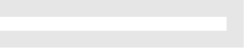
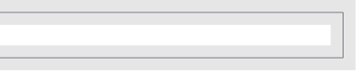
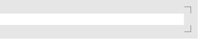
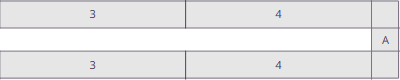
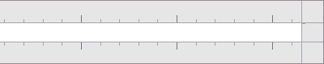
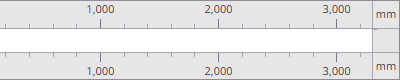
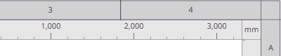

# Exporting and printing

| | |
|---|---|
 | Export tab |

To export your plan as a bitmap image or vector file, open the **Export** tab.

On the **Export** tab, you can select an output folder, an output file type and configure
the appearance of your exported file.

By default, Planner will try and export to the folder where your plan is saved. The appearance of
the export is inherited from your editing appearance the first time you open the **Export** tab.

## Export types

Planner can export raster bitmaps in **PNG** format, or scalable vector illustrations in **SVG** format.

### Raster bitmap

**PNG** files are bitmap files that are made up of pixels. They have a fixed resolution and can only be zoomed
in so far before they become blurry. **PNG** exports are limited to 32,767 pixels per side and 100 million
pixels overall, including borders. If your export exceeds these limits, reduce its resolution or crop area.
Only **PNG** files support **Composite** effects.

### Optimized PNG

**Optimized PNG** reduces the image to a palette of up to 256 colours. It can produce smaller files,
but quantization may change colours and gradients. Use regular **PNG** to retain the original colours.

### Scalable vector

**SVG** files are vector illustrations and are made up of strokes and paths. This means they don't have a fixed
resolution and can be scaled as much as the user desires. **SVG** files do not support **Composite** effects.

## Export region

When you enter the **Export** tab for the first time, Planner will automatically crop your plan to its contents.
The crop area is marked by dashed lines surrounding the canvas - drag these handles around to change the crop area.
`Double-click` a crop handle to reset it to its default position.

The grid can be offset here as well - simply `Drag` the rulers to offset the plan's origin. This setting only
applies to the export tab - your editing canvas is unaffected.

Use the Export tab's controls to change grid and dimension visibility. The editor's
`G` and `M` shortcuts and corresponding View menu options are disabled in Export.
Reference images cannot be loaded, shown, or configured while Export is active.

## Scale

### Digital

When exporting a **PNG**, choose a scale and a scale unit. At a scale of 100 with a scale unit
of **px/m** (pixels per meter), every 100 pixels on the exported file is equal to 1 meter.

When exporting an **SVG**, the only scale unit is **units/m**, which is generic SVG units
(sometimes called pixels) for every meter. A scale of 100 uses 100 SVG units for every meter on the canvas.

### Architectural

Architectural mode allows you to set a print scale. At a scale of 1:100, a wall measuring 1 meter on the
canvas measures 10 millimeters on paper.

When exporting **PNG**, an additional option called **PPI** is available. **PPI** is pixels per inch,
and is a number used in print to decide how large to print an image. **PPI** might be commonly referred
to as DPI.

Typically, 300 PPI is standard definition, 600 PPI is high resolution.

## Export appearance and options

### Canvas

| | |
|---|---|
| **Theme** | Set the theme used by the export canvas. |
| **Background** | Override the theme's canvas color. |
| **Walls** | Set how walls are rendered. |
| **Lines** | Override the theme's linework color. |
| **Solid Objects** | Set whether objects have fills that cover the grid. |

### Border

Set a border for the exported image, or no border.

| | |
|---:|---|
| **None** | No border. |
| **Plain** |  |
| **Frame** |  |
| **Corner Marks** |  |
| **Reference Zones** |  |
| **Marked** |  |
| **Ruler** |  |
| **Ruler + Reference Zones** |  |

### Grid and line weight

Configure the appearance of the grid and linework on the exported image.

### Measurements and visibility

Hide or show measurements and entire classes of objects from the exported image.

### Title Block

Enable **Draw Title Block** to append a bordered strip to the **Right** or **Bottom** of the exported drawing.
This option is off by default and appears in the export preview and exported file, not on the normal editor canvas.
The strip extends the export bounds without changing the drawing's scale or crop.
Small exports receive enough additional space to fit the block.

The project name defaults to the project's filename, without its extension, and can be edited.
Enter the drawing title, address, prepared by, and comments or reference information.
Enable **Logo** to choose an image to include. Cancelling the file picker leaves it disabled if no image is selected.
The cell fits the image's proportions and the image is saved with the project.
Disable **Logo** to remove its cell; the selected image is retained so it can be enabled again.
Text uses the canvas font. Cell sizes follow the content, with a compact bottom layout and no cell for empty comments.
The sheet number defaults to **0001** and can be edited; revision is optional.
**Date** defaults to today. Use its dropdown calendar to choose a different date, or its refresh button to reset to today.
Scale is filled automatically.
The sheet-number cell stays at the bottom for the right layout and at the right for the bottom layout.

### Composite effects

If you have chosen to export in a raster format like **PNG**, you can add compositing
effects to your exported plan.

Available effects are **Vignette** and **Texture**.

**Vignette** darkens the edges of the texture. It is corrected for aspect ratio.

**Texture** allows you to add a textured overlay to your image. You can adjust its
overall strength, and the strength of its highlights, midtones and shadows individually.
Adjust **Angle** to shift the light source, and adjust **Scale** to resize the overlay.
At a scale of 1, each source texture pixel maps to one output pixel.

For output or preview problems, see [Troubleshooting](troubleshooting.md).

[> Next: Keyboard and mouse shortcuts](shortcuts.md)

[< Previous: Projects and recovery](projects.md)

[<< Back to Help](README.md)
